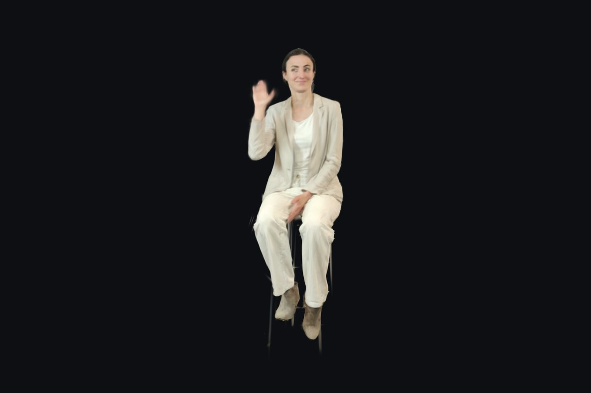

# Ithaca 4DGS JS player (WebGL2)

4D Gaussian Splatting videos made with [ITHACA](https://www.ithaca.eu) as **objects** for WebGL2 3D apps, WebXR scenes
and metaverses — not a viewer page. Add an `Ithaca4DGS` to your three.js (or A-Frame) scene, next to your other
objects: move, rotate and scale it like any `Object3D`, and it plays by itself, with spatial sound, in VR, AR or on a
flat screen.

[](https://www.ithaca.eu/?ithaca_partage=FTTN757OptLt3aresYXUV9B-)

*Hello ITHACA 4DGS!, played by this player ([watch it in 4D](https://www.ithaca.eu/?ithaca_partage=FTTN757OptLt3aresYXUV9B-)).*

**Examples to download:** the [ITHACA Featured 4DGS gallery](https://www.ithaca.eu/featured-4dgs/) — download button
on each video (`.4dgs` or `.ftgsz`, both read by this player), or play them directly by their share link.

- **Files**: `.4dgs` (one file: sequences, sound, framing; streamed by HTTP ranges), `.ftgsz` sequences, raw `.ply`
  sequences of ITHACA renders, ITHACA `manifest.json` (sequences next to it) — from a URL or a local `File`
- **ITHACA links**: a share link (`https://www.ithaca.eu/?ithaca_partage=…`) or its token plays directly
- **Featured 4DGS**: `listFeatured()` returns the videos of the ITHACA gallery (title, creator, thumbnails, duration…)
- HD and Low Quality ITHACA renders
- Plays while loading: decoding and depth sorting run in Web Workers; the next sequence is fetched, decoded, uploaded
  and pre-sorted before it is needed; the sound is the master clock
- WebGL 2, three.js ≥ 0.160 (peer dependency), MIT licence, no other dependency

---

## Install it in your WebGL2 JavaScript 3D app

Requirements: a browser with **WebGL 2** (all current desktop and mobile browsers, Meta Quest browser), **three.js
0.160 or later** in your app, and **HTTPS** for VR / AR (WebXR). The player uses your app's three.js: it must be the
same `three` module (one copy), as for any three.js add-on.

### 1. Add the package

**With a bundler (Vite, webpack 5, Rollup, Parcel…)**

```sh
npm install three ithaca-4dgs-js-player
```

The two Web Workers of the player are written as `new Worker(new URL(…, import.meta.url))`: Vite and webpack 5 find
and bundle them by themselves, nothing to configure.

**Without a build step (plain `<script type="module">`)** — map `three` and the player in an import map, from a CDN or
from your own server:

```html
<script type="importmap">
{
  "imports": {
    "three": "https://cdn.jsdelivr.net/npm/three@0.170.0/build/three.module.js",
    "three/addons/": "https://cdn.jsdelivr.net/npm/three@0.170.0/examples/jsm/",
    "ithaca-4dgs-js-player": "https://cdn.jsdelivr.net/npm/ithaca-4dgs-js-player@0.1.0/src/index.js"
  }
}
</script>
```

Loaded from another site (a CDN), the workers start anyway: the player starts them through a small same-origin stub.
To self-host instead, copy the `src/` folder to your site and map `ithaca-4dgs-js-player` to `/your/path/src/index.js`.

### 2. Add a video to your scene

```js
import * as THREE from "three";
import { Ithaca4DGS } from "ithaca-4dgs-js-player";

// your app: renderer, scene, camera (any setup works)
const renderer = new THREE.WebGLRenderer({ antialias: true });      // WebGL 2 (three.js default)
renderer.setSize(innerWidth, innerHeight);
document.body.appendChild(renderer.domElement);
const scene = new THREE.Scene();
const camera = new THREE.PerspectiveCamera(50, innerWidth / innerHeight, 0.05, 500);
camera.position.set(0, 1.6, 3);

// spatial sound (optional): one listener on the camera
const listener = new THREE.AudioListener();
camera.add(listener);

// the 4D video: an object of the scene
const video = new Ithaca4DGS({ src: "https://www.ithaca.eu/?ithaca_partage=FTTN757OptLt3aresYXUV9B-", listener });
video.position.set(0, 0, -1);        // framed ITHACA videos stand on y = 0, in metres
video.rotation.y = Math.PI / 6;
scene.add(video);

video.addEventListener("ready", () => console.log("on screen,", video.duration.toFixed(1), "s"));
video.addEventListener("error", (e) => console.error(e.error));

// your render loop: nothing to call for the video, it updates itself when the scene is rendered
renderer.setAnimationLoop(() => renderer.render(scene, camera));
```

That is all. Several videos can play in the same scene; each one is an independent object (`video.visible = false`
hides it, `scene.remove(video); video.dispose()` frees it).

### 3. VR and AR (WebXR)

Nothing specific to the player: enable WebXR on your renderer as usual, the video is drawn for each eye.

```js
import { VRButton } from "three/addons/webxr/VRButton.js";     // or ARButton for passthrough AR
renderer.xr.enabled = true;
document.body.appendChild(VRButton.createButton(renderer));
```

### 4. Sound and autoplay

Browsers start sound only after a user gesture. If the sound is blocked the video still plays; call `video.play()`
from a click, a tap or a controller button to start the sound.

### 5. Your own servers

To play files hosted on your servers from your app's pages:

- **CORS**: the files must be readable from your app's origin (`Access-Control-Allow-Origin`).
- **`.4dgs`**: the server must answer HTTP range requests (`Range` / `206 Partial Content`, as every static server
  and S3-like storage do), expose `Content-Range` to the page (`Access-Control-Expose-Headers: Content-Range`) and
  accept the `Range` header in CORS preflights (`Access-Control-Allow-Headers: Range`).
- `.ftgsz`, `.ply` and `manifest.json` are read in one piece: plain CORS is enough.

ITHACA share links and the Featured 4DGS gallery are read from `www.ithaca.eu`, which serves them to any site.

---

## Sources

| `src` | What is read |
|---|---|
| `"video.4dgs"` | the whole video: sequences, sound, framing (by HTTP ranges, while it plays) |
| `"https://www.ithaca.eu/?ithaca_partage=<token>"`, `"ithaca:<token>"` or `"<token>"` | an ITHACA share: its `.4dgs`, or its sequences and sound, with the framing set by its owner. Each opening counts one view of the share. Signed links are refreshed when they expire |
| `"…/manifest.json"` | an ITHACA render folder (HD or Low Quality sequences listed in the manifest) |
| `"seq001.ftgsz"`, `"seq001.ply"` | one HD sequence |
| `"seg1.ftgsz"` / `"seg1.ply"` with `frames: 65` | one Low Quality sequence: its file does not say its frame count, give it |
| a `File` or `Blob` (file picker, drag and drop) | any of the formats above; use `format` when the name does not tell |

Raw sequences, manifests and `.ftgsz` carry no framing: position, rotate and scale the object yourself (a raw Low
Quality sequence also holds the whole captured room). `.4dgs` files and share links come framed (the platform's position,
rotation and crop box) unless `applyFraming: false`.

```js
// a file chosen by the user
input.onchange = () => scene.add(new Ithaca4DGS({ src: input.files[0] }));
// a lone Low Quality sequence
scene.add(new Ithaca4DGS({ src: "seg1.ply", frames: 65 }));
```

## Featured 4DGS gallery

```js
import { listFeatured, Ithaca4DGS } from "ithaca-4dgs-js-player";

const { total, videos, categories } = await listFeatured({ sort: "popular", perPage: 20, headset: true });
for (const v of videos) {
  // v: { token, title, creator, views, category, type, headset, download, duration, gaussians, bytes,
  //      thumbnail, animatedThumbnail, pageUrl }
  addMenuItem(v.title, v.thumbnail, () => scene.add(new Ithaca4DGS({ src: v.token, listener })));
}
```

Options: `query` (search), `sort` (`"recent"`, `"popular"`, `"name"`), `perPage` (20 or 50), `page`, `category` and
`type` (keys of `categories` / `types` in the answer), `headset` (only the videos made for headsets).

`resolveShare(token)` returns the description of a share (title, fps, frames, framing, sequence and sound links) without
playing it; `shareToken(url)` extracts the token of a share link; `shareUrl(token)` builds its page address.

## Ithaca4DGS reference

### Options

| Option | Default | |
|---|---|---|
| `src` | — | a source (see above); or call `load(src)` later |
| `autoplay` | `true` | start as soon as the first sequence is on screen |
| `loop` | `true` | loop the video |
| `listener` | `null` | a `THREE.AudioListener` for spatial sound (no sound without it) |
| `fps` | `30` | frame rate when the source does not say |
| `applyFraming` | `true` | apply the framing set on the ITHACA platform (`.4dgs`, share links) |
| `frames` | `null` | frame count of a lone Low Quality sequence |
| `format` | `null` | `"4dgs"`, `"manifest"`, `"ftgsz"` or `"ply"` when the name does not tell (a `Blob`) |
| `server` | `"https://www.ithaca.eu"` | ITHACA site that resolves share links |
| `fetchFn` | `fetch` | custom fetch (headers, credentials, signed URLs…) |

### Properties and methods

- `play()`, `pause()`, `currentTime` (seconds, read / write), `duration`, `playing`, `ready`, `waiting`
- `load(src, { frames, format })` — open a video
- `share` — the share description when playing an ITHACA link (title, page URL…)
- `boundingSphere()` — sphere of the video in world space (to place or frame it)
- `stats` — worker timings (`sortMs`, `decodeMs`, …), visible and total gaussians
- `dispose()` — frees the GPU memory, the workers and the sound

### Events (`addEventListener`)

`load` (index read; `share` for ITHACA links), `ready` (first sequence on screen), `waiting` / `playing` (buffering),
`progress` (`{ loaded, total }` sequences), `ended`, `error` (`{ error }`).

## A-Frame

```html
<script src="https://aframe.io/releases/1.6.0/aframe.min.js"></script>
<script type="module">
  import "ithaca-4dgs-js-player/aframe";   // registers the ithaca-4dgs component (after A-Frame)
</script>

<a-scene>
  <a-entity ithaca-4dgs="src: https://www.ithaca.eu/?ithaca_partage=FTTN757OptLt3aresYXUV9B-; loop: true; sound: true"
            position="0 0 -2"></a-entity>
</a-scene>
```

Schema: `src`, `loop`, `autoplay`, `sound`, `frames`. The entity emits `ithaca-4dgs-ready`, `ithaca-4dgs-ended`, … (the
events above, prefixed).

## Other exports

- `SplatMesh` — the WebGL2 renderer alone (one packed sequence on the GPU), for custom players
- `TurntableControls` — level turntable camera (orbit, pan, zoom, WASD flight), used by the example page
- `open4dgs(url, { signal, fetchFn })` — `.4dgs` index reader; `is4dgs(src)` — a `.4dgs` address or file

## Example and tests

```sh
npm install
npm run serve                                  # http://localhost:8770/examples/?src=<a .4dgs, a share link…>
python3 test/sources.py                        # every kind of source, headless Chromium (Playwright)
python3 test/render.py <file.4dgs> [time_s]    # headless render, screenshots in test/sortie/
python3 test/perf.py <file.4dgs> <name>        # worker timings
```

Test files are not included: download examples from the [Featured 4DGS gallery](https://www.ithaca.eu/featured-4dgs/)
or use your own ITHACA renders (`test/data/`).

## Licence

MIT — © 2026 French Touch Factory / ITHACA. See [LICENSE](LICENSE).
